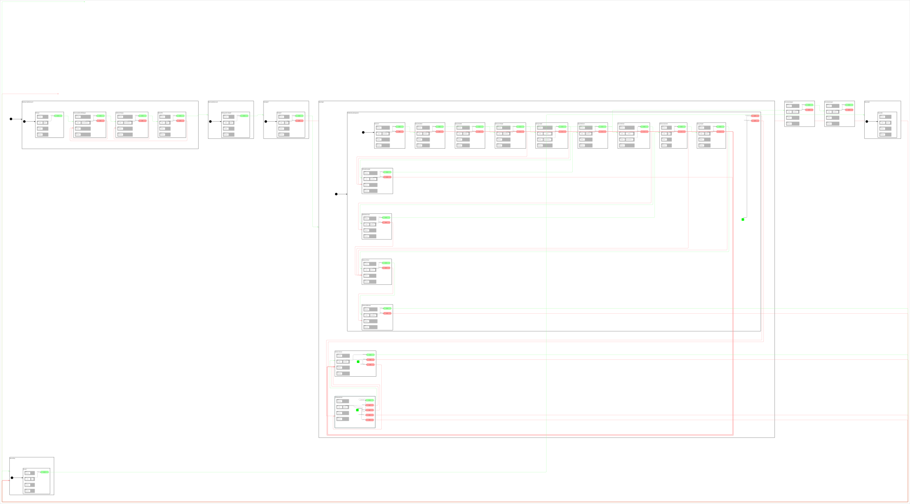

<h2>State Machine Diagram</h2>

 

<h2>Description</h2>

An Iris quadrotor with a forward RGB-D camera inspects the shelf aisles of the
Isaac Sim *Full Warehouse*, flown by PX4 SITL through the
[Pegasus Simulator](https://github.com/PegasusSimulator/PegasusSimulator) extension.
From the pad south of the racks it flies to the south corridor, then a serpentine
up and down all six aisles at 2.5 m with the camera looking along the direction of
travel, turning in the open corridors at the aisle ends. In aisle 3 it turns to face
the rack and flies the aisle sideways twice, north at the upper shelf level and back
south at the lower one, so the box tracker counts the cartons head-on (`SsRackScan`);
at the mouth of aisle 5 it stops in front of the wet-floor signs and cones, drops to
1.2 m, pans across the spill and climbs back (`StDescendToSpill`, `StInspectSpill`,
`StClimbFromSpill`). The sixth (east) aisle is
blocked by the warehouse's parked forklift: the depth camera's forward safety cone
stops the vehicle (`StObstacleHold`) and the mission escapes back to the north
corridor, along it and down aisle 5 to the south corridor (`StReturnHome`). In front
of the pad it pans the camera across the rack ends (`StScanShelves`), climbs to 4.5 m
and flies the finale over the open floor with the camera along the path: three
loiter laps (`StOverviewLoiter`) and a double figure eight (`StFigureEight`, the new
`CbLemniscate` path follower), then returns over the pad, descends and lands.

The camera (color image, metric depth, camera_info) and the vehicle's ground-truth
pose are published to ROS 2 by Pegasus's ROS 2 backend. Isaac Sim stamps the camera
topics with simulation time, so `scripts/camera_restamp.py` restamps the depth image
and its camera_info in ROS time, pairs them and throttles them to 15 Hz (the color
image likewise, for RViz); the pair becomes a point cloud (`depth_image_proc`) that
gates the flight: a return inside the forward
cone stops the vehicle, a cloud that stops arriving aborts the aisle leg the same
way. RViz shows the camera image, the depth cloud, the TF tree
(`map -> base_link -> camera`) broadcast from PX4's own estimate by `CpTfBroadcaster`,
the flown trail, and Pegasus's ground-truth pose next to it. All tunables (altitudes,
speed, leash, cone, timeouts, spawn point, corridors, aisles, overview) live in
`config/mission_constants.hpp`; the warehouse dimensions in its header were measured
from the USD.

Uses three orthogonals:
- **OrPx4** - `cl_px4_mr::ClPx4Mr` for all PX4 vehicle control, plus `CpTfBroadcaster`
- **OrCamera** - `cl_generic_sensor::ClGenericSensor<sensor_msgs::msg::PointCloud2>` on
  `/camera/points` with a 2 s message watchdog, plus `CpForwardObstacleGuard`
- **OrTimer** - `cl_ros2_timer::ClRos2Timer` for the camera pan duration

<h2>Build Instructions</h2>

First, source your ROS 2 installation.
```
source /opt/ros/jazzy/setup.bash
```

Then build with colcon build...
```
colcon build --packages-select cl_px4_mr sm_pegasus_demo_1
```

<h2>One-time Setup</h2>

Build PX4 SITL once:
```
cd ~/workspaces/PX4-Autopilot
make px4_sitl
```

Install the system dependencies declared in package.xml (`depth_image_proc`, which
turns the depth image into the point cloud the flight is gated on):
```
rosdep install --from-paths src --ignore-src -r -y
```

Pegasus Simulator (extension mode) with its `configs.yaml` pointing `px4_dir` at the
PX4 checkout above and `px4_default_airframe: gazebo-classic_iris`. The Pegasus GUI
spawns the vehicle with one backend only; the local patch in
`extensions/pegasus.simulator/pegasus/simulator/ui/ui_delegate.py` adds a
publish-only ROS 2 backend (camera + ground truth, namespace `drone<Vehicle ID>`)
whenever the PX4 backend is selected, configures the camera at 640x480, 15 Hz with
depth (pinhole, 70 deg), defaults "autostart PX4" to off and runs the PX4 backend
without lockstep (with lockstep Pegasus blocks Isaac Sim until PX4 answers every
sensor message; PX4 1.16 stops answering while disarmed in OFFBOARD and the whole
simulator froze at the first arming). Isaac Sim must be started with its internal ROS 2 Jazzy bridge
(`isaac_run` in `~/.bashrc` sets that up).

<h2>Operating Instructions</h2>

Requires Isaac Sim plus four terminals, started in this order. PX4 runs in lockstep
with Isaac Sim and connects to the Pegasus vehicle on TCP port 4560, so the
simulation must be playing before PX4 starts. The micro-ROS agent must be running
before the state machine starts: `StConnectMicroROSAgent` waits for the agent's node
and for PX4 to report a healthy position estimate, then `StWaitForReady` refuses to
arm until the EKF heading holds still and matches the parked heading (east).

**Isaac Sim - Pegasus Simulator tab:**
1. Scene: `Full Warehouse`, *Load Scene*
2. Vehicle: `Iris`, Vehicle ID `0`, Position `0, 0, 0.07`, Rotation `0, 0, 0`
   (must match `kSpawnWorld` in `config/mission_constants.hpp`)
3. Backend: PX4, **autostart PX4 unchecked** (Terminal 1 starts it), *Load Vehicle*
4. Press *Play*

**Terminal 1 - PX4 SITL** (the `none` simulator target: PX4 attaches to the external
simulator already listening on port 4560, Iris airframe)
```
cd ~/workspaces/PX4-Autopilot
make px4_sitl none_iris
```

**Terminal 2 - QGroundControl** (GCS heartbeat so PX4 allows arming)
```
./QGroundControl-x86_64.AppImage
```

**Terminal 3 - micro-ROS agent (XRCE-DDS bridge to PX4):**
```
ros2 run micro_ros_agent micro_ros_agent udp4 -p 8888 2>&1 | tee /tmp/xrce_agent.log
```

**Terminal 4 - camera pipeline, RViz and the State Machine:**
```
source install/setup.bash
ros2 launch sm_pegasus_demo_1 sm_pegasus_demo_1.launch.py
```
`run_sm:=false` brings up only the camera pipeline and RViz, to look at the image,
the depth cloud and the TF tree without flying; `camera_rate:=<Hz>` throttles the
depth stream (default 15).

The state machine's console output is also written to `/tmp/sm_pegasus_demo_1_latest.log`.

<h2>Box tracker</h2>

`scripts/box_tracker.py` is an image-based cardboard-box tracker local to this
mission: YOLO-World (zero-shot; the large `yolov8l-worldv2` with the prompts
"cardboard box", "carton", "package", "parcel" at confidence 0.15 - the small model
found almost nothing on the stocked racks) plus ByteTrack on the relayed color image, publishing the annotated image on `/box_tracker/image` (an RViz
panel next to the camera) and `vision_msgs/Detection2DArray` with track ids on
`/box_tracker/detections`. The overlay shows the boxes in the current frame (top
left), the unique boxes tracked so far (top right) and the per-zone inventory the
state machine publishes on `/inspection/inventory` (bottom); cardboard boxes are
drawn orange, traffic cones blue, the forklift green. The state machine's `OrTracker`
orthogonal (`CpBoxInventory`) tallies unique track ids per zone - each aisle leg,
rack pass and the spill stop names its zone - and logs the table at the end. It runs
in its own venv (torch + ultralytics; the ROS environment still provides rclpy,
cv_bridge and vision_msgs) through `box_tracker.sh`; create the venv once:
```
python3 -m venv --system-site-packages --without-pip ~/venvs/box_tracker
curl -sSL https://bootstrap.pypa.io/get-pip.py | ~/venvs/box_tracker/bin/python -I -
echo "numpy<2" > ~/venvs/box_tracker/constraints.txt
~/venvs/box_tracker/bin/python -m pip install -c ~/venvs/box_tracker/constraints.txt torch torchvision ultralytics
```
(numpy stays below 2 so the system cv_bridge keeps working.) The launch points the
node at `~/venvs/box_tracker/yolov8l-worldv2.pt`; ultralytics downloads the weights
there on first use (`cd ~/venvs/box_tracker && bin/python -c "from ultralytics import
YOLOWorld; YOLOWorld('yolov8l-worldv2.pt').set_classes(['cardboard box'])"`), and the
CLIP text encoder into `~/.cache`.

**Fine-tuning on the scene.** The zero-shot model misses the small parcels and
dense stacks. `scripts/isaac_capture_dataset.py` (Isaac Sim Python, Script Editor:
`exec(open("<path>").read())`, later `capture.stop()`) labels the warehouse prims
(cardboard boxes, traffic cones, the forklift), attaches Replicator's tight 2D box
annotator to the drone camera and saves a frame plus boxes every 15 app updates to
`~/datasets/warehouse_boxes` while you fly the mission. Then
```
~/venvs/box_tracker/bin/python scripts/train_box_detector.py --epochs 40
```
converts it to a YOLO dataset, fine-tunes `yolov8s` on the GPU and writes
`~/venvs/box_tracker/box_detector.pt`; point the launch's `model` parameter at it
(the `classes` prompts are ignored for a fine-tuned model). `tracker:=false` skips it; a
fine-tuned YOLO weight file replaces the zero-shot model through the `model`
parameter.

<h2>Filming: chase camera</h2>

`scripts/isaac_chase_camera.py` runs inside Isaac Sim (not ROS): it creates a camera
prim re-posed every frame from the Pegasus vehicle state - 3 m behind, 1.2 m above,
levelled, heading smoothed, always aimed at the vehicle - and opens it in a
"Chase Camera" viewport window (1920x1080) to record from. The patched Pegasus GUI
delegate loads it automatically at *Load Vehicle* (path from `SM_PEGASUS_DEMO_1_CHASE_CAMERA_SCRIPT`,
default: this file in the workspace). To start it by hand in a running session:
*Window > Script Editor*, then
```
exec(open("/home/brettpac/workspaces/isaac_ros-dev/src/pegasus_sm_library/sm_pegasus_demo_1/scripts/isaac_chase_camera.py").read())
```
and retune live with `chase.set(back=4.0, up=1.5, focal_length=24.0)`, or remove it
with `chase.stop()`. All defaults are in `DEFAULTS` at the top of the script.

<h2>Negative Tests</h2>

- Obstacle in the cone: built in - the forklift parked in the east aisle (world
  x 1.4..4.9, y 10.2..11.4, 2.15 m tall) is met on the last aisle; expect
  `CpForwardObstacleGuard: OBSTACLE`, `StObstacleHold`, then `StReturnHome` escaping
  via aisle 5, then the pan, the overview and a landing on the pad. Delete the
  forklift prim in the stage to see the nominal path instead.
- Cloud loss: `pkill -f point_cloud_xyz_node` kills only the depth-to-cloud node;
  expect `[CpMessageTimeout] Message timeout occurred` within 2 s, then `StReturnHome`.

<h2>Viewer Instructions</h2>

If you have the SMACC2 Runtime Analyzer installed then type...
```
ros2 run smacc2_rta smacc2_rta
```

If you don't have the SMACC2 Runtime Analyzer click <a href="https://robosoft.ai/product-category/smacc2-runtime-analyzer/">here</a>.
